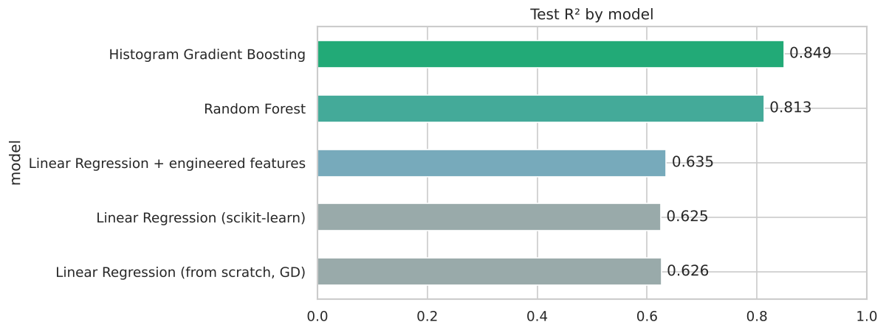
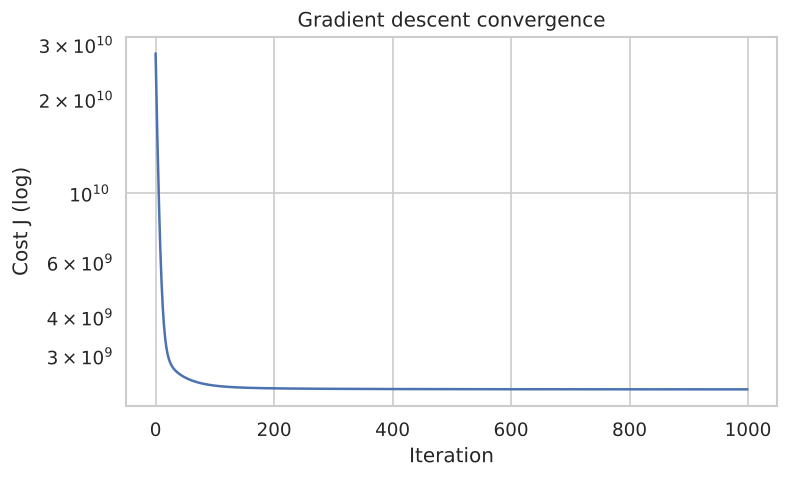
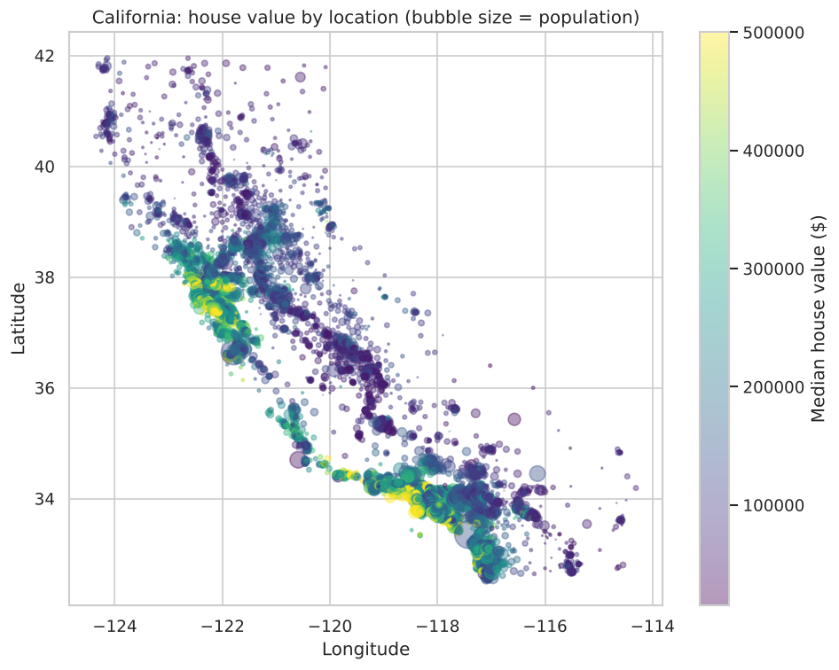

# 🏠 California House Prices — Linear Regression from Scratch → Gradient Boosting

Predicts the median house value of California districts from 1990 census data. The project has two parts:

1. **Linear Regression written from scratch** in NumPy (gradient descent), wrapped as a scikit-learn estimator and verified against scikit-learn.
2. **Feature engineering + tree ensembles** to go well beyond the linear baseline.



## Results (test set, 4,128 districts)

| Model | R² | MAE |
|---|---|---|
| Linear Regression — **from scratch** (gradient descent) | 0.626 | $50,622 |
| Linear Regression — scikit-learn (closed form) | 0.625 | $50,670 |
| Linear Regression + engineered features | 0.635 | $49,645 |
| Random Forest | 0.813 | $31,767 |
| **Histogram Gradient Boosting** | **0.849** | **$29,174** |

The from-scratch model matches scikit-learn almost exactly, which validates the maths. Switching to gradient boosting raises R² from **0.63 to 0.85** and cuts the average error by about **40%**.

## Linear Regression from scratch

```python
class LinearRegressionFromScratch(BaseEstimator, RegressorMixin):
    def fit(self, X, y):
        m, n = X.shape
        self.w_, self.b_ = np.zeros(n), 0.0
        for _ in range(self.iterations):
            error = X @ self.w_ + self.b_ - y          # ŷ − y
            self.w_ -= self.lr * (1 / m) * (X.T @ error)  # ∂J/∂w
            self.b_ -= self.lr * (1 / m) * np.sum(error)  # ∂J/∂b
        return self
```

| Convergence | Location matters |
|---|---|
|  |  |

## Insights

* **Median income** is the strongest single predictor.
* Coastal districts (Bay Area, Los Angeles) are the most expensive; `INLAND` is much cheaper. This location effect is non-linear, which is why tree models win.
* Ratio features (`rooms_per_household`, `bedrooms_ratio`, `people_per_household`) describe a typical home better than raw district totals.
* **Limitation:** the target is capped at $500,001 (965 districts), so expensive areas are always under-predicted.

## Run it

```bash
pip install -r requirements.txt
jupyter notebook california_house_prices.ipynb
```

**Data:** California Housing (1990 census), `data/housing.csv`, 20,640 districts.

**Tech:** Python · NumPy · pandas · scikit-learn · seaborn

---

## 👤 Author

**Reda Akram** — Computer Science (AI) student at the University of Technology, Baghdad. I build ML models, automation systems and AI agents.

GitHub: [@devb777r](https://github.com/devb777r)
